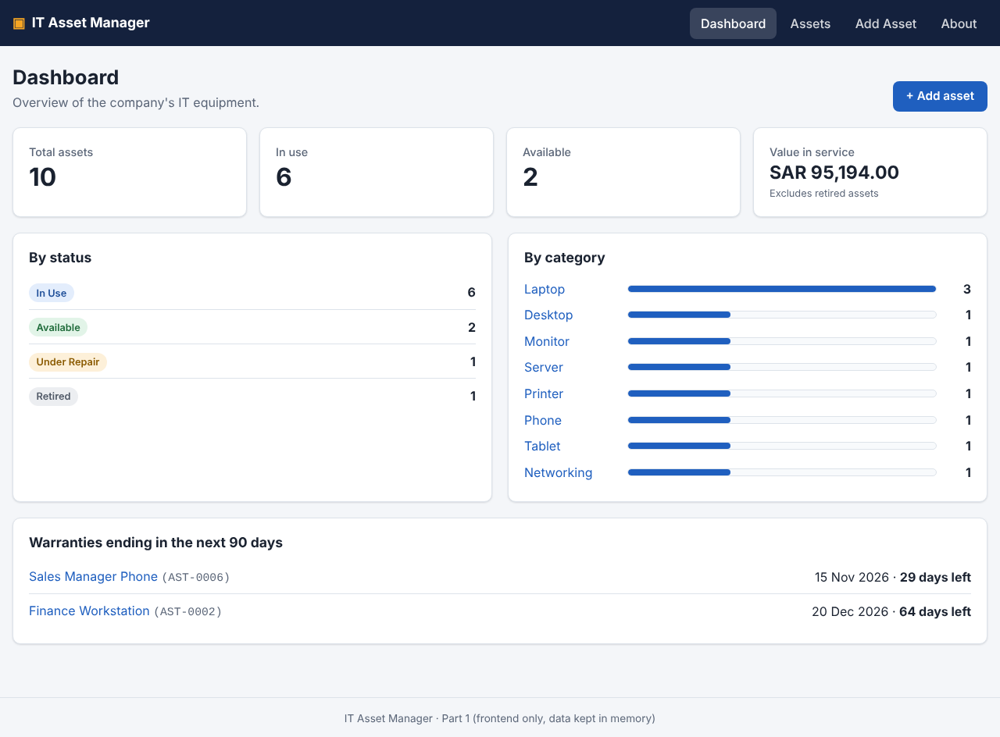

# IT Asset Manager

A React web application for managing a company's **IT assets** — laptops, desktops, monitors, servers,
printers, phones, tablets and network devices. Users can **add, view, update, delete and search** assets
from a single, menu-driven interface.

> **Course project – Part 1 (frontend only).** As required, the data is a collection of JavaScript
> objects kept in memory — there is no database yet. Changes are lost when the page is reloaded.
> The backend will be coded manually in Part 2.



---

## Contents

- [Features](#features)
- [Getting started](#getting-started)
- [Available scripts](#available-scripts)
- [Project structure](#project-structure)
- [How the assignment requirements are met](#how-the-assignment-requirements-are-met)
- [Documentation](#documentation)
- [Team](#team)

---

## Features

| Feature | Where |
|---|---|
| Menu to move between every feature (collapses on phones) | Top bar on every page |
| Dashboard: totals, value in service, counts by status and category, warranties ending soon | **Dashboard** |
| Display all assets in a table (card layout on phones) | **Assets** |
| Search by name, ID, serial, brand, model, person, department or location | **Assets** |
| Filter by category and status, sort by any main column | **Assets** |
| Add an asset with full validation | **Add Asset** |
| View every detail of one asset | Click an asset name |
| Update an asset | **Edit** button |
| Delete an asset (with a confirmation dialog) | **Delete** button |
| Team members (name and student ID) | **About** |

See [docs/FEATURES.md](docs/FEATURES.md) for the full list and screenshots.

## Getting started

**Requirements:** [Node.js](https://nodejs.org/) 22.13 or newer (the current LTS works). Check with `node -v`.

```bash
git clone <this-repository-url>
cd it-asset-manager
npm install
npm run dev
```

Then open the address shown in the terminal (normally <http://localhost:5173>).

## Available scripts

| Command | What it does |
|---|---|
| `npm run dev` | Starts the development server with hot reload |
| `npm test` | Runs all 70 automated tests once |
| `npm run test:watch` | Re-runs tests whenever a file changes |
| `npm run coverage` | Runs the tests and prints a code-coverage report |
| `npm run lint` | Checks the code with oxlint |
| `npm run build` | Creates the production build in `dist/` |
| `npm run preview` | Serves the production build locally |

## Project structure

```
src/
├── main.jsx                  Entry point – mounts <App />
├── App.jsx                   Router: the list of pages
├── index.css                 All styles (light + dark theme)
├── components/               Reusable pieces of UI
│   ├── Layout.jsx            Page frame (menu, content, footer)
│   ├── NavBar.jsx            The main menu
│   ├── AssetForm.jsx         Form shared by "Add" and "Edit"
│   ├── AssetTable.jsx        Table of assets with actions
│   ├── ConfirmDialog.jsx     "Are you sure?" pop-up
│   ├── Notice.jsx            Success message after an action
│   ├── PageHeader.jsx        Title row of each page
│   └── StatusBadge.jsx       Coloured status label
├── pages/                    One file per screen
│   ├── DashboardPage.jsx
│   ├── AssetListPage.jsx
│   ├── AssetDetailsPage.jsx
│   ├── AddAssetPage.jsx
│   ├── EditAssetPage.jsx
│   ├── AboutPage.jsx
│   ├── AssetNotFound.jsx
│   └── NotFoundPage.jsx
├── context/                  App-wide data (state management)
│   ├── AssetProvider.jsx     Holds the assets; add / update / delete
│   ├── assetReducer.js       Pure function that applies each change
│   ├── assetContextObject.js The React context object
│   └── useAssets.js          Hook pages use to reach the data
├── data/
│   ├── initialAssets.js      The starting collection of 10 assets
│   └── team.js               Team members shown on the About page
├── constants/
│   └── assetOptions.js       Categories, statuses, departments, sort fields
└── utils/                    Plain functions (no React) – easy to test
    ├── validation.js         All input rules
    ├── filterAssets.js       Search, filter and sort
    ├── stats.js              Dashboard numbers
    ├── dates.js              Date helpers
    ├── format.js             Currency / date display
    └── ids.js                Asset ID generation
tests/
├── unit/                     Tests for the plain functions
└── integration/              Tests that render the app and click through it
docs/                         Project documentation (see below)
```

## How the assignment requirements are met

| # | Requirement | How it is met |
|---|---|---|
| 1 | The project must be a React project | React 19 app built with Vite |
| 2 | A menu to navigate between features | `NavBar.jsx`: Dashboard · Assets · Add Asset · About |
| 3 | Manage data: add, remove, update, search, display | Add Asset page, Delete button + confirmation, Edit page, search/filter bar, table + details page |
| 4 | About page with team members (name, student ID) + menu item | `AboutPage.jsx`, data in `src/data/team.js`, menu item **About** |
| – | Data is a collection of objects, not a database | `src/data/initialAssets.js`, kept in React state |
| – | Documentation: architecture, technology stack, features | [ARCHITECTURE](docs/ARCHITECTURE.md), [TECH_STACK](docs/TECH_STACK.md), [FEATURES](docs/FEATURES.md) |
| – | Generate tests and run them | 70 tests, all passing — see [TESTING](docs/TESTING.md) |
| – | AI code review (security, performance, quality, reuse) | [CODE_REVIEW](docs/CODE_REVIEW.md) |
| – | Use an AI tool for requirements, visual design and code | [REQUIREMENTS](docs/REQUIREMENTS.md), [UI_DESIGN](docs/UI_DESIGN.md), [AI_USAGE](docs/AI_USAGE.md) |

## Documentation

| Document | Contents |
|---|---|
| [REQUIREMENTS.md](docs/REQUIREMENTS.md) | Functional and non-functional requirements, data model, validation rules |
| [UI_DESIGN.md](docs/UI_DESIGN.md) | Visual design: pages, layout, colours, typography, accessibility |
| [ARCHITECTURE.md](docs/ARCHITECTURE.md) | How the app is organised and how data flows |
| [TECH_STACK.md](docs/TECH_STACK.md) | Every technology used and why |
| [FEATURES.md](docs/FEATURES.md) | Each feature explained, with screenshots |
| [TESTING.md](docs/TESTING.md) | Test strategy, full list of tests, latest results and coverage |
| [CODE_REVIEW.md](docs/CODE_REVIEW.md) | AI code review: security, performance, quality, reuse |
| [AI_USAGE.md](docs/AI_USAGE.md) | Which AI tool was used and for what |

## Team

| Name | Student ID |
|---|---|
| Mohammad Aldemaiji | 222110184 |
| Abdulmalik Mohamede | 221211415 |
| Abdulrahman Makhanik | 222110452 |
| Ibrahim Aldayhani | 222111329 |
