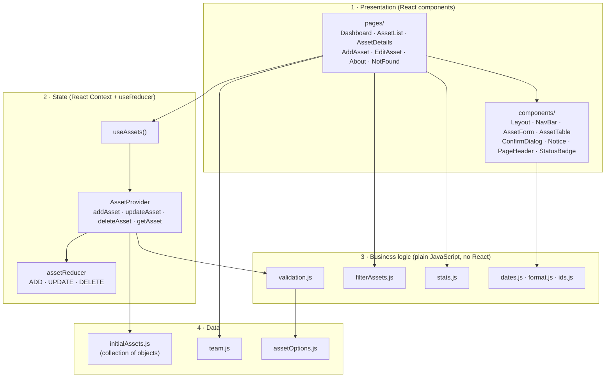
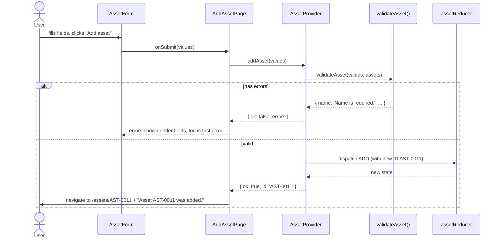

# Architecture

## 1. Overview

IT Asset Manager is a **single-page application (SPA)**. The browser downloads one HTML page and the
JavaScript bundle once; after that, React Router swaps pages without reloading.

The code is split into four layers. Each layer only uses the layers below it:



| Layer | Folder | Responsibility | Knows about React? |
|---|---|---|---|
| Presentation | `src/pages`, `src/components` | What the user sees and clicks | Yes |
| State | `src/context` | Holds the asset collection; the only place it changes | Yes |
| Business logic | `src/utils` | Validation, search/sort, statistics, formatting | **No** |
| Data | `src/data`, `src/constants` | Starting data and fixed option lists | No |

Keeping the business logic free of React makes it simple to test (42 of the 70 tests run without
rendering anything) and lets Part 2 reuse it on the server.

## 2. Routing

Defined in `src/App.jsx`. Every route renders inside `Layout` (menu + footer).

| URL | Page | Purpose |
|---|---|---|
| `/` | `DashboardPage` | Summary |
| `/assets` | `AssetListPage` | Display, search, filter, sort, delete |
| `/assets?q=dell&status=In+Use` | `AssetListPage` | Same, with filters taken from the URL |
| `/assets/new` | `AddAssetPage` | Add |
| `/assets/:id` | `AssetDetailsPage` | View one asset, delete |
| `/assets/:id/edit` | `EditAssetPage` | Update |
| `/about` | `AboutPage` | Team members |
| anything else | `NotFoundPage` | 404 message |

## 3. State management

The asset collection is stored once, in `AssetProvider`, using React's `useReducer`:

```js
state = {
  assets: [ { id: 'AST-0001', name: 'Developer Laptop 01', ... }, ... ],
  nextId: 11   // next number to use for a new asset ID
}
```

- **Pages never change the array directly.** They call `addAsset`, `updateAsset` or `deleteAsset`
  from the `useAssets()` hook.
- **Every write is validated first** inside the provider, so no page can store bad data by mistake.
  Each operation returns `{ ok: true, id }` or `{ ok: false, errors }`.
- **The reducer is a pure function.** It never edits the old state — it always returns new arrays/objects.
  This is what lets React detect changes, and it makes the reducer easy to test.
- **IDs are never reused.** `nextId` only increases, so deleting `AST-0010` and adding a new asset
  gives `AST-0011`, not `AST-0010` again.

Why Context + `useReducer` and not Redux? The app has one collection and three operations. React's
built-in tools cover that with no extra library, while still giving a single, predictable place where
data changes.

## 4. Data flow examples

### Adding an asset



### Searching

1. The user types in the search box.
2. `AssetListPage` writes the text to the URL (`?q=...`) with `setSearchParams`.
3. The page reads the URL, then calls `filterAssets(assets, { query, category, status, sortBy, sortDir })`
   inside `useMemo`, so the list is only recomputed when one of those inputs changes.
4. The table re-renders with the matching rows and the live count updates.

### Deleting

1. **Delete** opens `ConfirmDialog` (focus starts on *Cancel*).
2. On confirm, the page calls `deleteAsset(id)` → reducer `DELETE` → new array without that asset.
3. The page navigates (replace) with a `notice` in router state, and `Notice` shows the success message.

## 5. Component responsibilities

| Component | Responsibility | Used by |
|---|---|---|
| `Layout` | Page frame with `<header>`, `<main>`, `<footer>` | All routes |
| `NavBar` | Menu links, active highlight, mobile toggle | `Layout` |
| `AssetForm` | Controlled form, shows errors, focuses first error | Add, Edit |
| `AssetTable` | Table rows with View/Edit/Delete | Asset list |
| `ConfirmDialog` | Accessible modal, Escape/backdrop to cancel | Asset list, Details |
| `Notice` | One-time success message from navigation state | Asset list, Details |
| `PageHeader` | Title, subtitle, action buttons | All pages |
| `StatusBadge` | Coloured status label | Table, Details, Dashboard |

## 6. Preparing for Part 2 (backend)

Pages only talk to data through `useAssets()`. In Part 2, only `AssetProvider` needs to change:

| Part 1 (now) | Part 2 (planned) |
|---|---|
| `initialAssets.js` loaded into state | `GET /api/assets` on start |
| `addAsset` → reducer `ADD` | `POST /api/assets`, then add the saved asset |
| `updateAsset` → reducer `UPDATE` | `PUT /api/assets/:id` |
| `deleteAsset` → reducer `DELETE` | `DELETE /api/assets/:id` |
| ID created in the browser | ID created by the database |

`validation.js` can be reused on the server so the same rules are enforced on both sides.
