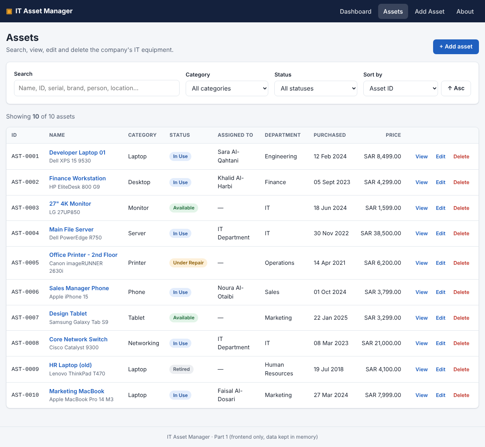
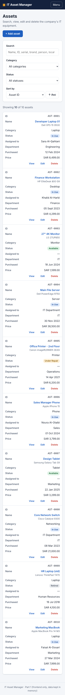
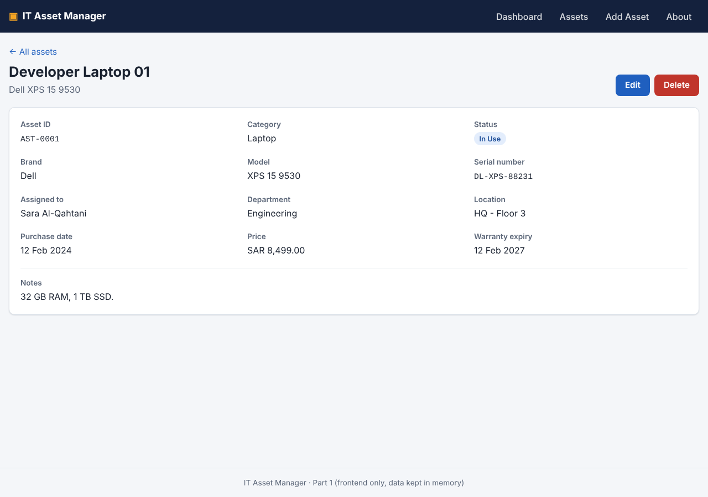
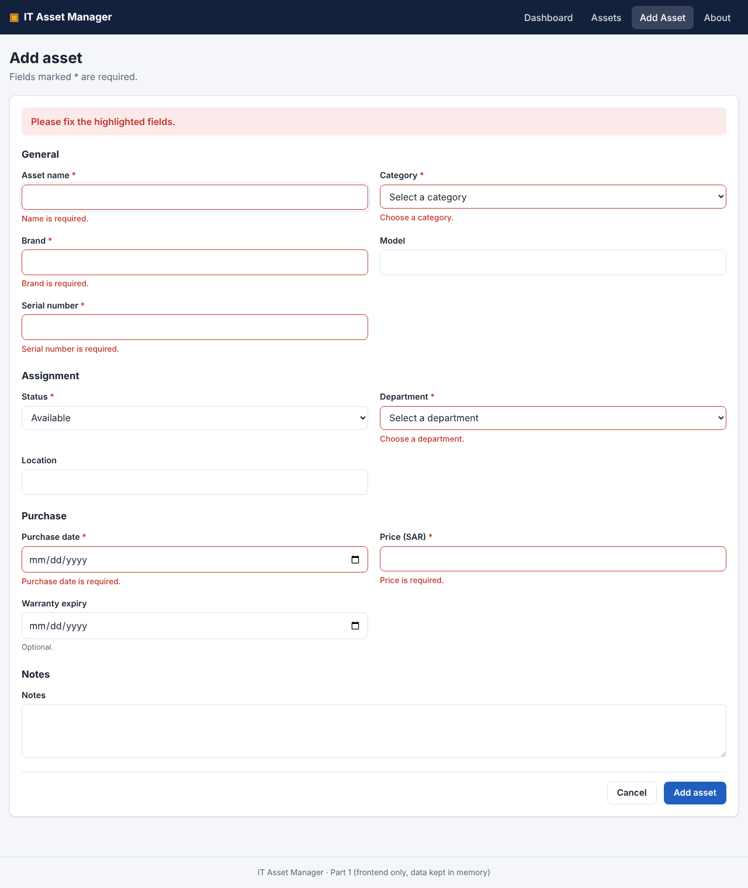
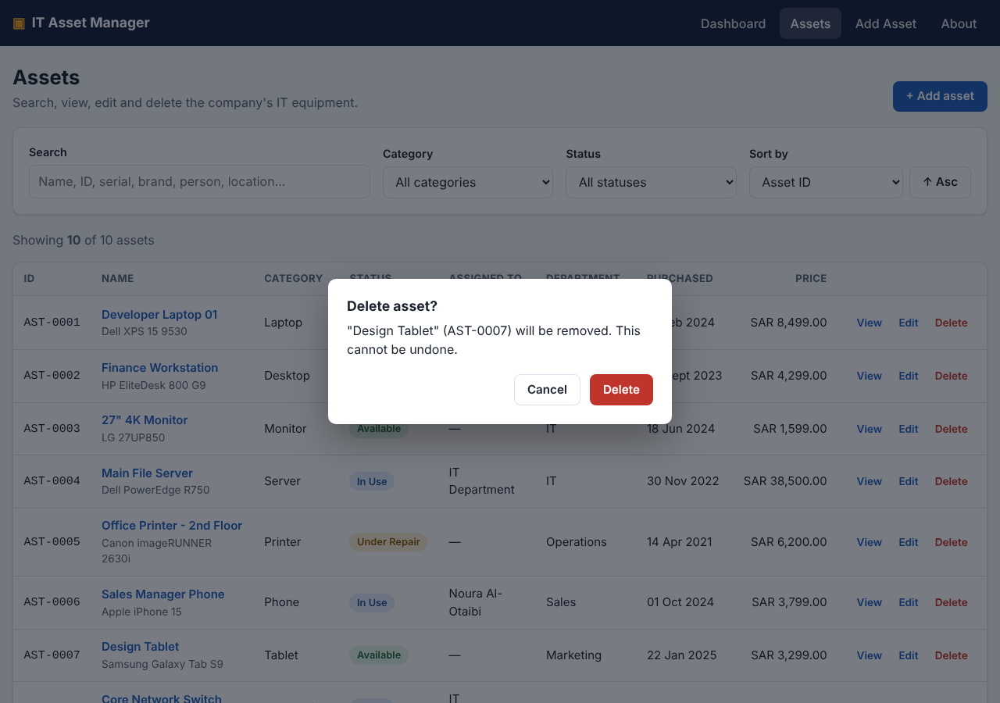
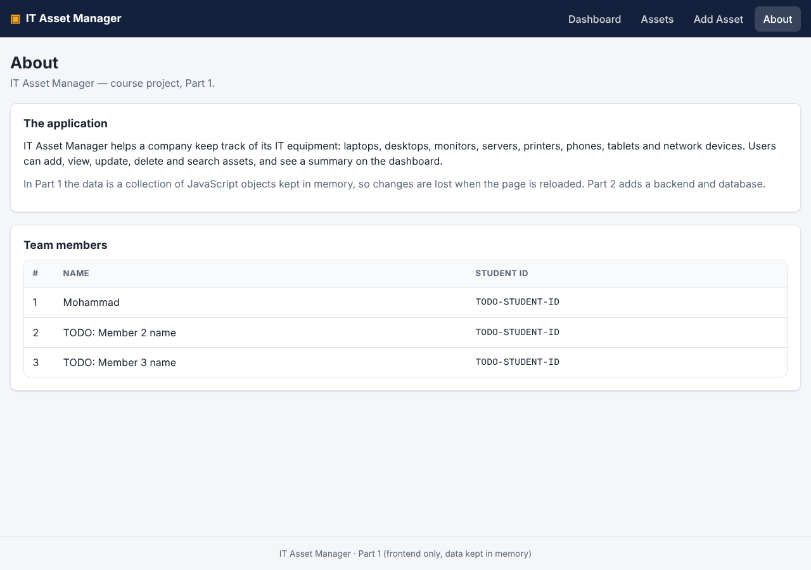

# Features

## 1. Navigation menu

A dark menu bar is visible on every page with four items: **Dashboard**, **Assets**, **Add Asset**
and **About**. The current page is highlighted. On screens narrower than 720 px the items collapse
behind a **Menu** button.

## 2. Dashboard

- **Summary tiles:** total assets, in use, available, and *value in service* (sum of purchase prices,
  excluding retired assets).
- **By status:** count per status. Clicking a status opens the asset list filtered by it.
- **By category:** a bar for each category. Clicking a category opens the filtered list.
- **Warranties ending in the next 90 days:** assets still in service whose warranty ends soon,
  soonest first, with the number of days left.

## 3. Display assets

The **Assets** page shows every asset in a table: ID, name (with brand and model), category,
status badge, assigned person, department, purchase date and price. Each row has **View**, **Edit**
and **Delete** buttons. On phones the table turns into easy-to-read cards:

Clicking an asset's name opens its **details page** with every field and its notes:

## 4. Search, filter and sort

On the **Assets** page:

- **Search** looks in ID, name, brand, model, serial number, assigned person, department and
  location. It ignores upper/lower case and extra spaces, and updates as you type.
- **Category** and **Status** filters can be combined with each other and with search.
- **Sort by** ID, name, category, status, purchase date or price; the **Asc/Desc** button flips the order.
- "Showing *X* of *Y* assets" tells you how many match. **Clear filters** resets search and filters.
- Settings are stored in the URL (e.g. `/assets?q=dell&status=In%20Use`), so the browser's Back
  button returns to the same results.
- If nothing matches, the page says so instead of showing an empty table.

## 5. Add an asset

**Add Asset** (menu) or **+ Add asset** (button) opens a form grouped into *General*, *Assignment*,
*Purchase* and *Notes*. Required fields are marked with a red `*`.

- The **Assigned to** field appears only when the status is *In Use*.
- On save, the app gives the asset the next ID (e.g. `AST-0011`), opens its details page and shows
  "Asset AST-0011 was added."
- If anything is wrong, nothing is saved: each problem is shown under its field, a summary appears at
  the top, and the cursor jumps to the first problem.

Validation rules are listed in [REQUIREMENTS.md §6](REQUIREMENTS.md#6-validation-rules).

## 6. Update an asset

**Edit** (from the list or the details page) opens the same form filled with the asset's current
values. The same validation applies — and an asset may keep its own serial number. **Save changes**
returns to the details page with "Changes saved." **Cancel** leaves without changing anything.

## 7. Delete an asset

**Delete** (from the list or the details page) opens a confirmation dialog naming the asset.
The *Cancel* button has focus, so pressing Enter by accident does not delete anything; **Escape** or
clicking outside also cancels. After confirming, the asset is removed and a message confirms it.

## 8. About page

Describes the application and lists the team members with their **name and student ID**.
Names and IDs are edited in one place: `src/data/team.js`.

## 9. Other details

- **Not found pages** for unknown URLs and for asset IDs that do not exist (e.g. after a delete).
- **Dark mode** follows the operating system setting.
- **Keyboard friendly:** everything can be done without a mouse; focus is always visible.
- **Data in memory:** as required for Part 1, the data is a collection of objects. Reloading the page
  restores the 10 sample assets.
